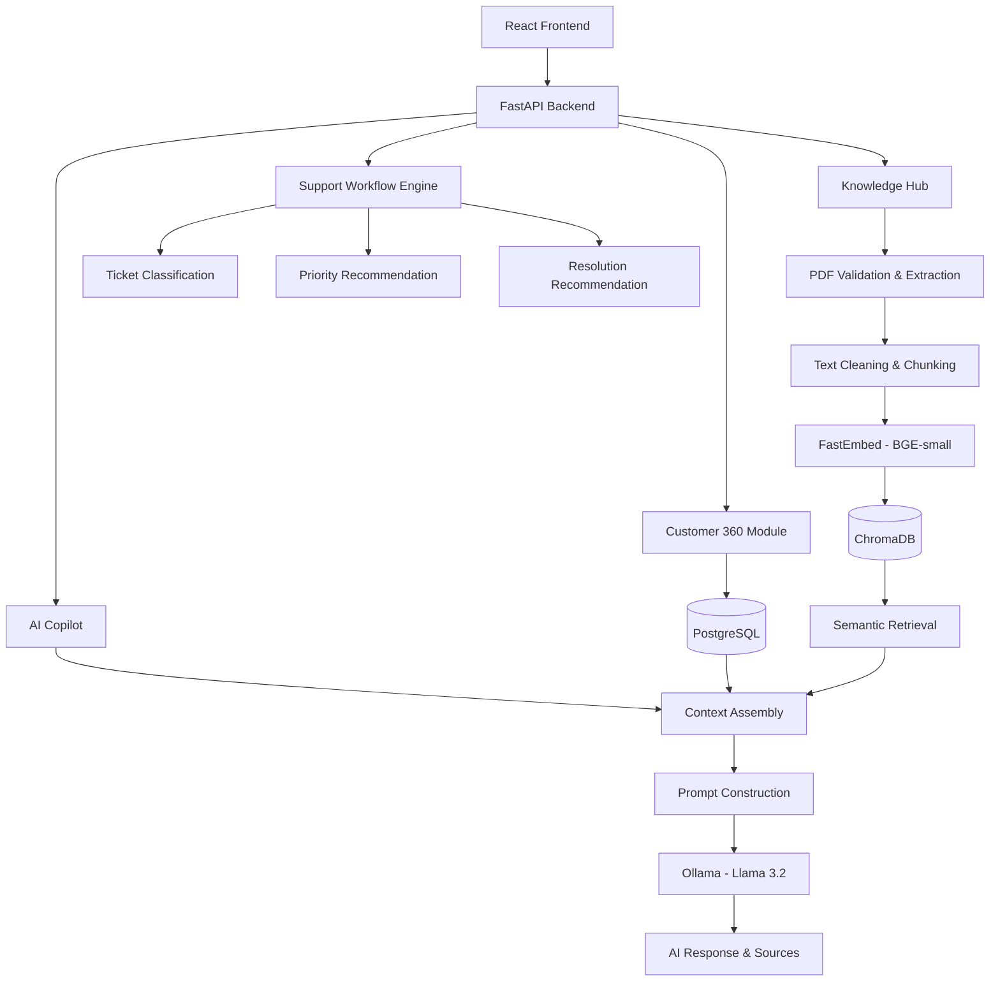

# 🧠 EnterpriseBrain 360
### AI-Powered Enterprise Knowledge & Customer Intelligence Platform

**A local-first, privacy-conscious enterprise platform that unifies customer data, support workflows and enterprise knowledge through Retrieval-Augmented Generation (RAG) and a context-aware AI Copilot.**


<div align="center">

**[Overview](#-overview) · [Highlights](#-key-highlights) · [Architecture](#-architecture) · [Features](#-implemented-features) · [Tech Stack](#-tech-stack) · [Quick Start](#-quick-start) · [Roadmap](#-project-status)**

</div>

---

## 🚀 Overview

Enterprise support teams often work across disconnected CRM systems, support ticketing platforms and scattered documentation. Finding the right information requires switching between tools and manually connecting customer history with internal knowledge.

**EnterpriseBrain 360** addresses this challenge through a unified platform that combines Customer 360 management, enterprise document intelligence, semantic retrieval and AI-assisted support workflows.

The platform enables support teams to:

- Access consolidated customer profiles, support tickets and interaction history.
- Upload and process enterprise PDF documents into a searchable knowledge base.
- Retrieve relevant information using semantic search.
- Ask natural-language questions and receive answers grounded in enterprise documentation.
- Generate customer-aware responses using CRM records and retrieved knowledge.
- Analyze support tickets and receive classification, priority and resolution recommendations.

### Project Modules

| Module | Functionality | Status |
|---|---|---|
| 👥 **Customer 360** | Customer profiles, tickets and interaction history | ✅ Implemented |
| 📚 **Knowledge Hub** | PDF ingestion, extraction, chunking and embeddings | ✅ Implemented |
| 🔎 **Semantic Search** | Vector-based retrieval using ChromaDB | ✅ Implemented |
| 🤖 **RAG Pipeline** | Context retrieval and grounded AI responses | ✅ Implemented |
| 🧠 **AI Copilot** | Customer-aware and general knowledge assistance | ✅ Implemented |
| ⚙️ **Support Workflows** | Ticket classification, priority and resolution recommendations | ✅ Implemented |
| 🖥️ **React Dashboard** | Unified interface for customer, ticket, knowledge and Copilot workflows | ✅ Implemented |

### Why Local-First AI?

Enterprise documents and customer records can contain sensitive information. EnterpriseBrain 360 uses locally hosted embeddings and an Ollama-powered language model to process knowledge and generate responses without relying on third-party hosted LLM APIs.

---

## ⭐ Key Highlights

- **End-to-end enterprise platform:** Integrated Customer 360, Knowledge Hub, RAG, AI Copilot and support workflow modules.
- **Modular REST API architecture:** Built backend services with FastAPI, Pydantic validation and PostgreSQL relational data management.
- **Secure PDF ingestion:** Validates file extension, MIME type, file size and PDF signature before processing.
- **Intelligent document processing:** Extracts PDF content page by page, cleans text and creates overlapping chunks with preserved metadata.
- **Local semantic embeddings:** Generates 384-dimensional embeddings using FastEmbed and BGE-small.
- **Persistent vector storage:** Stores document embeddings and metadata in ChromaDB for semantic retrieval.
- **Context-aware AI assistance:** Combines customer profiles, tickets, interaction history and enterprise knowledge to answer questions.
- **Source-aware responses:** Returns document and page references alongside retrieved knowledge.
- **Automated support recommendations:** Analyzes tickets to recommend categories, priorities and knowledge-grounded resolution steps.
- **Interactive React dashboard:** Provides a unified interface for managing customers, support tickets, knowledge documents and AI assistance.

---

## 🏗️ Architecture



### Target Request Flow

1. **Ingest:** Upload an enterprise PDF through the Knowledge Hub.
2. **Process:** Extract text page by page, clean content and create overlapping chunks.
3. **Embed:** Generate local 384-dimensional embeddings using BGE-small.
4. **Store & Retrieve:** Persist vectors in ChromaDB and retrieve relevant chunks using semantic similarity.
5. **Add Customer Context:** Retrieve customer profiles, support tickets and interactions from PostgreSQL.
6. **Generate:** Assemble relevant context and send it to the locally hosted Llama 3.2 model through Ollama.
7. **Respond:** Return an AI-generated answer with relevant document and page references.

---

## ✨ Implemented Features

### 👥 1. Customer 360

- Implemented CRUD REST APIs for customer records, support tickets and customer interactions.
- Designed a relational PostgreSQL schema with primary keys, foreign keys, indexes and data constraints.
- Developed a consolidated Customer 360 endpoint that retrieves customer details, associated tickets and interaction history.
- Added customer-specific context retrieval for AI-assisted support.

### 📚 2. Enterprise Knowledge Hub

- Implemented PDF upload APIs with extension, MIME type, file-size and PDF-signature validation.
- Extracted page-wise document content using PyMuPDF.
- Added text cleaning, whitespace normalization and overlapping chunking with word-boundary adjustment.
- Preserved source filename, chunk ID and page number as document metadata.
- Generated local embeddings using FastEmbed and BGE-small.
- Stored document vectors and metadata in persistent ChromaDB storage.
- Built semantic search APIs to retrieve relevant document chunks.

### 🔎 3. Retrieval-Augmented Generation (RAG)

- Implemented semantic retrieval over the enterprise knowledge base.
- Integrated ChromaDB retrieval with locally generated embeddings.
- Added relevance filtering to reduce unrelated document retrieval.
- Constructed prompts using retrieved enterprise document context.
- Integrated Ollama with Llama 3.2 for local response generation.
- Added source and page references to knowledge-grounded responses.

### 🤖 4. Context-Aware AI Copilot

- Developed a Copilot API that supports both general knowledge questions and customer-specific queries.
- Integrated PostgreSQL customer context with enterprise document retrieval.
- Built context formatting and prompt construction services.
- Generated responses using the locally hosted Llama 3.2 model.
- Returned retrieved knowledge sources alongside AI-generated answers.

### ⚙️ 5. Intelligent Support Workflows

- Implemented rule-based ticket classification for payment, billing, account, technical and general categories.
- Developed a priority recommendation engine for urgent, high, medium and low-priority tickets.
- Built a resolution recommendation engine that retrieves relevant enterprise knowledge before generating suggestions.
- Integrated workflow analysis with ticket records and knowledge retrieval.
- Exposed ticket analysis through dedicated workflow APIs.

### 🖥️ 6. React Frontend

- Built a dark-themed React dashboard using Vite.
- Developed dedicated interfaces for Customers, Support Tickets, AI Copilot and Knowledge Hub.
- Integrated frontend components with FastAPI endpoints.
- Added customer and ticket management interfaces.
- Implemented PDF upload, semantic search and AI knowledge-query interfaces.
- Integrated AI Copilot interactions and support workflow recommendations.

---

## 🛠️ Tech Stack

| Layer | Technology |
|---|---|
| Programming Language | Python 3.13, JavaScript |
| Frontend | React, Vite, CSS |
| Backend | FastAPI, Pydantic, Uvicorn |
| Database | PostgreSQL 17, Psycopg |
| Document Processing | PyMuPDF |
| Embeddings | FastEmbed, BGE-small (384 dimensions) |
| Vector Database | ChromaDB |
| LLM Runtime | Ollama, Llama 3.2 1B |
| AI Architecture | Retrieval-Augmented Generation (RAG) |
| API Testing | Swagger UI, Postman |
| Testing | Pytest |

---

## 📂 Project Structure

```text
EnterpriseBrain-360/
│
├── backend/
│   ├── copilot/
│   │   ├── context_service.py
│   │   ├── context_formatter.py
│   │   ├── knowledge_service.py
│   │   ├── prompt_service.py
│   │   └── router.py
│   │
│   ├── knowledge/
│   │   ├── router.py
│   │   ├── document_processor.py
│   │   ├── embedding_service.py
│   │   ├── vector_store.py
│   │   ├── rag_service.py
│   │   └── llm_service.py
│   │
│   ├── workflows/
│   │   ├── ticket_classifier.py
│   │   ├── priority_engine.py
│   │   ├── resolution_engine.py
│   │   └── router.py
│   │
│   ├── main.py
│   ├── customer.py
│   ├── ticket.py
│   ├── interaction.py
│   ├── schemas.py
│   ├── database.py
│   └── config.py
│
├── frontend/
│   ├── src/
│   │   ├── pages/
│   │   │   ├── CustomersPage.jsx
│   │   │   ├── TicketsPage.jsx
│   │   │   ├── CopilotPage.jsx
│   │   │   └── KnowledgeHubPage.jsx
│   │   ├── services/
│   │   │   └── api.js
│   │   ├── App.jsx
│   │   └── main.jsx
│   └── package.json
│
├── data/
│   ├── documents/
│   ├── sample_data/
│   └── chroma_db/
│
├── docs/
├── .gitignore
└── README.md
```

---

## ⚙️ Quick Start

### Prerequisites

- Python 3.13+
- Node.js 20+
- PostgreSQL 17+
- Git
- [Ollama](https://ollama.com)

### 1. Clone the Repository

```bash
git clone https://github.com/Anushree195/EnterpriseBrain-360.git
cd EnterpriseBrain-360
```

### 2. Configure the Backend

```powershell
cd backend

python -m venv .venv
.\.venv\Scripts\Activate.ps1
```

Install the backend dependencies:

```powershell
python -m pip install -r requirements.txt
```

### 3. Configure PostgreSQL

Create the project database:

```sql
CREATE DATABASE enterprisebrain_db;
```

Create a `backend/.env` file:

```env
DB_HOST=localhost
DB_PORT=5432
DB_NAME=enterprisebrain_db
DB_USER=postgres
DB_PASSWORD=your_local_password
```

Ensure the PostgreSQL tables and required schema are initialized before starting the backend.

### 4. Start Ollama

Pull the local language model:

```powershell
ollama pull llama3.2:1b
```

Make sure the Ollama service is running before using the AI features.

### 5. Start the Backend

From the `backend` directory:

```powershell
python -m uvicorn main:app --reload
```

Backend API:

`http://127.0.0.1:8000`

Interactive Swagger documentation:

`http://127.0.0.1:8000/docs`

### 6. Start the Frontend

Open a separate terminal:

```powershell
cd frontend
npm install
npm run dev
```

Frontend:

`http://localhost:5173`

---

## 🔌 API Modules

| Route Prefix | Purpose |
|---|---|
| `/customers` | Customer CRUD and consolidated Customer 360 profile |
| `/tickets` | Support ticket management |
| `/interactions` | Customer interaction history |
| `/knowledge` | PDF upload, document processing, semantic search and knowledge queries |
| `/copilot` | General and customer-aware AI assistance |
| `/workflows` | Ticket classification, priority and resolution analysis |

Explore and test the endpoints using FastAPI Swagger UI at `/docs`.

---

## 🗺️ Project Status

**Core implementation completed**

- [x] Project architecture and FastAPI foundation
- [x] PostgreSQL integration and relational schema
- [x] Customer, ticket and interaction CRUD APIs
- [x] Consolidated Customer 360 profile
- [x] Secure PDF upload and validation
- [x] PDF extraction, cleaning and overlapping chunking
- [x] Local embeddings using FastEmbed and BGE-small
- [x] Persistent ChromaDB vector storage
- [x] Semantic document retrieval
- [x] RAG pipeline with Ollama
- [x] Source-aware knowledge responses
- [x] Context-aware AI Copilot
- [x] Intelligent ticket classification and priority recommendations
- [x] Knowledge-grounded resolution suggestions
- [x] React dashboard and API integration

**Future enhancements**

- [ ] Expand automated unit and integration test coverage.
- [ ] Improve citation validation and answer-quality evaluation.
- [ ] Add comprehensive end-to-end testing and performance benchmarks.
- [ ] Add authentication, role-based access control and production deployment.
- [ ] Extend monitoring, logging and operational observability.

---

## 🔐 Security & Design Principles

- **Local-first AI:** Uses local embeddings and Ollama inference rather than third-party hosted LLM APIs.
- **Secure configuration:** Keeps database credentials and environment-specific secrets in `.env` files excluded from version control.
- **Layered file validation:** Validates uploaded PDF files using multiple checks before processing.
- **Data integrity:** Uses PostgreSQL constraints, relationships and indexes to maintain structured customer data.
- **Modular architecture:** Separates customer management, knowledge processing, AI Copilot and workflow services.
- **Context-grounded responses:** Uses retrieved enterprise knowledge and customer records to provide relevant AI assistance.

---

## 🧭 Design Decisions

| Decision | Reasoning |
|---|---|
| **FastAPI** | Provides modular REST APIs, request validation and interactive API documentation. |
| **PostgreSQL** | Customer, ticket and interaction records are relational and require data integrity. |
| **FastEmbed + BGE-small** | Provides lightweight local embedding generation with 384-dimensional vectors. |
| **ChromaDB** | Enables persistent vector storage and semantic similarity retrieval. |
| **Ollama + Llama 3.2** | Enables locally hosted language-model inference without external LLM API keys. |
| **Overlapping chunks** | Preserves relevant context across document chunk boundaries. |
| **Page-level metadata** | Helps trace retrieved information back to its source document and page. |
| **RAG architecture** | Grounds generated responses in retrieved enterprise knowledge rather than relying only on model parameters. |

---

## 👩‍💻 Author

**Anushree Sindagi**  
B.Tech in Information Technology

[](https://github.com/Anushree195)
[](https://www.linkedin.com/in/anushree-sindagi-842675259/)

**Repository:** [EnterpriseBrain-360](https://github.com/Anushree195/EnterpriseBrain-360)

---

<div align="center">

**EnterpriseBrain 360**  
*Connecting Enterprise Knowledge with Customer Intelligence.*

⭐ If you find this project interesting, consider starring the repository.

</div>
