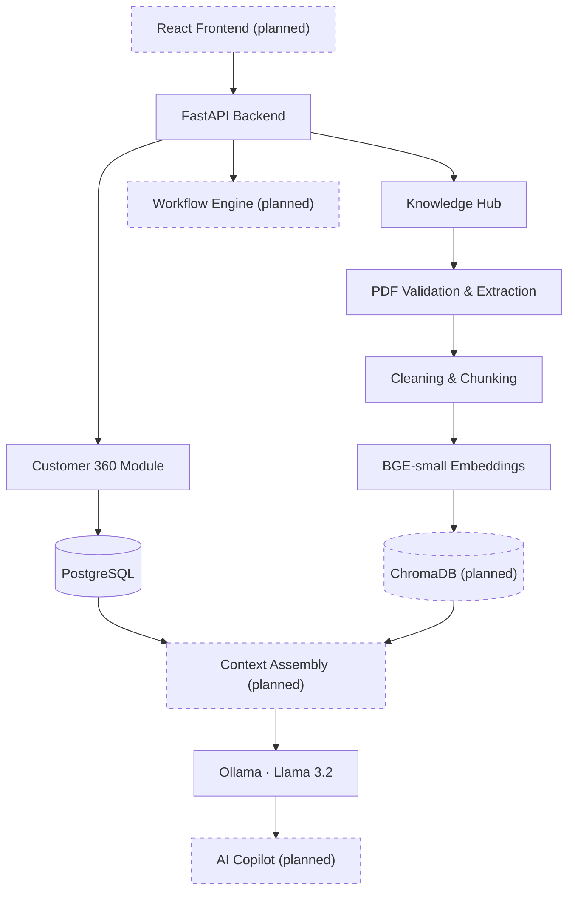

<div align="center">

# 🧠 EnterpriseBrain 360

### AI-Powered Enterprise Knowledge & Customer Intelligence Platform

**A local-first, privacy-friendly platform that unifies customer data and enterprise documents so support teams can find answers faster.**


[Overview](#-overview) · [Highlights](#-key-highlights) · [Architecture](#-architecture) · [Features](#-implemented-features) · [Quick Start](#-quick-start) · [Roadmap](#-roadmap)

</div>

---

## 🚀 Overview

Support teams lose time switching between ticketing tools, CRM records, and scattered documentation. **EnterpriseBrain 360** brings these together in a single backend platform:

| Module | What it does | Status |
|---|---|---|
| 👥 **Customer 360** | Unified customer profile: details, support tickets, and interaction history | ✅ Implemented |
| 📚 **Knowledge Hub** | PDF ingestion → text extraction → chunking → local embeddings | ✅ Implemented |
| 🔎 **Semantic Search** | Vector storage and similarity retrieval over documents (ChromaDB) | 🚧 In progress |
| 🤖 **AI Copilot** | Context-aware, citation-backed answers combining customer data and company knowledge | 📅 Planned |
| ⚙️ **Support Workflows** | Ticket classification, priority recommendations, resolution assistance | 📅 Planned |

> **Why local-first?** Enterprise documents and customer data are sensitive. This project uses open-source models (BGE embeddings, Llama via Ollama) that run entirely on your own machine, so no data is sent to third-party AI APIs.

---

## ⭐ Key Highlights

- **Production-style API design** — modular FastAPI services with Pydantic validation and a relational PostgreSQL schema (primary keys, foreign keys, constraints).
- **Secure document upload** — validates file extension, MIME type, file size, *and* the PDF magic-byte signature before processing.
- **Citation-ready ingestion** — every chunk keeps its source document, chunk ID, and page number so answers can later point back to the original page.
- **Overlapping, word-boundary-aware chunking** — preserves context across chunk edges and avoids cutting words in half.
- **Fully local AI stack** — FastEmbed (BGE-small, 384-dim vectors) + Ollama, with no external API keys required.

---

## 🏗️ Architecture



*Dashed nodes are planned and not yet implemented.*

### Target request flow

1. **Ingest** — A PDF is uploaded through the Knowledge Hub and validated.
2. **Process** — Text is extracted page by page, cleaned, and split into overlapping chunks.
3. **Embed** — Each chunk is converted into a 384-dimensional vector locally.
4. **Store & retrieve** — Vectors are stored in ChromaDB and queried by semantic similarity.
5. **Add customer context** — Profile, tickets, and history are pulled from PostgreSQL.
6. **Generate** — A local LLM answers using both sources and cites the document and page.

---

## ✨ Implemented Features

### 👥 Customer 360 Backend
- Full CRUD for customers, support tickets, and interactions.
- Relational schema with primary keys, foreign keys, and data constraints.
- A consolidated **Customer 360 endpoint** returning the customer, their tickets, and their interaction history in one response.

### 📚 Enterprise Knowledge Hub
- PDF upload API with layered validation (file type, content type, size, PDF signature).
- Page-wise text extraction using **PyMuPDF**.
- Text cleaning and whitespace normalization.
- Overlapping chunking with word-boundary adjustment.
- Metadata preservation (`source`, `chunk_id`, `page_number`) for future citations.
- Local embedding generation with **FastEmbed + BGE-small** (384 dimensions).

---

## 🛠️ Tech Stack

| Layer | Technology |
|---|---|
| Language | Python 3.13 |
| API | FastAPI, Pydantic, Uvicorn |
| Database | PostgreSQL 17 (`psycopg`) |
| Document processing | PyMuPDF |
| Embeddings | FastEmbed, BGE-small (384-dim) |
| LLM runtime | Ollama, Llama 3.2 1B |
| Vector store | ChromaDB *(planned)* |
| RAG orchestration | LangChain *(planned)* |
| Frontend | React *(planned)* |
| Testing | Pytest *(expanding)* |

---

## 📂 Project Structure

```text
EnterpriseBrain-360/
├── backend/
│   ├── knowledge/
│   │   ├── router.py              # Upload & processing endpoints
│   │   ├── document_processor.py  # PDF extraction, cleaning, chunking
│   │   └── embedding_service.py   # Local embedding generation
│   ├── main.py                    # App entry point
│   ├── customer.py                # Customer endpoints
│   ├── ticket.py                  # Support ticket endpoints
│   ├── interaction.py             # Interaction history endpoints
│   ├── schemas.py                 # Pydantic models
│   ├── database.py                # PostgreSQL connection
│   ├── config.py                  # Environment configuration
│   └── test_*.py                  # DB, document, chunking, embedding tests
├── frontend/                      # React app (planned)
├── data/
│   ├── documents/
│   └── sample_data/
├── docs/
└── README.md
```

---

## ⚙️ Quick Start

**Prerequisites:** Python 3.13+, PostgreSQL 17+, Git, [Ollama](https://ollama.com). Node.js 20+ is only needed once the frontend is added.

```bash
# 1. Clone
git clone https://github.com/Anushree195/EnterpriseBrain-360.git
cd EnterpriseBrain-360/backend
```

```powershell
# 2. Virtual environment (Windows PowerShell)
python -m venv .venv
.\.venv\Scripts\Activate.ps1

# 3. Dependencies
python -m pip install fastapi uvicorn "psycopg[binary]" python-dotenv pymupdf python-multipart fastembed
```

```sql
-- 4. Database
CREATE DATABASE enterprisebrain_db;
```

Create `backend/.env` (never commit this file):

```env
DB_HOST=localhost
DB_PORT=5432
DB_NAME=enterprisebrain_db
DB_USER=postgres
DB_PASSWORD=your_local_password
```

Create the `customers`, `support_tickets`, and `interactions` tables from the project schema.

```powershell
# 5. (Optional, for upcoming RAG integration) pull the local LLM
ollama pull llama3.2:1b

# 6. Run the API
python -m uvicorn main:app --reload
```

| Resource | URL |
|---|---|
| API | http://127.0.0.1:8000 |
| Interactive docs (Swagger) | http://127.0.0.1:8000/docs |
| Health check | http://127.0.0.1:8000/health |

---

## 🔌 API Modules

| Route prefix | Purpose |
|---|---|
| `/customers` | Customer lifecycle management and consolidated 360 profile |
| `/tickets` | Support ticket management |
| `/interactions` | Customer interaction history |
| `/knowledge` | Document upload and processing |

Browse and try every endpoint in Swagger UI at `/docs`.

---

## 🗺️ Roadmap

**Completed**
- [x] Project architecture and FastAPI foundation
- [x] PostgreSQL integration
- [x] Customer, ticket, and interaction APIs
- [x] Customer 360 consolidated profile
- [x] Secure PDF upload and validation
- [x] Text extraction, cleaning, and overlapping chunking
- [x] Local embeddings with BGE-small

**Next**
- [ ] ChromaDB vector storage
- [ ] Semantic similarity search endpoint
- [ ] RAG pipeline with Ollama
- [ ] Source-grounded answers with page-level citations
- [ ] Customer-context-aware responses

**Later**
- [ ] AI Copilot
- [ ] Ticket classification and priority recommendations
- [ ] React dashboard
- [ ] Automated test suite and CI

---

## 🔐 Security & Design Principles

- Secrets live in `.env` files that are excluded from version control.
- Uploaded files are validated on multiple signals, not just the file extension.
- Local-first inference keeps sensitive data on the user's own infrastructure.
- Modular boundaries (customer, knowledge, workflow) keep components independently testable and replaceable.

---

## 🧭 Design Decisions

| Decision | Reasoning |
|---|---|
| **FastEmbed + BGE-small** | Lightweight, runs on CPU, and produces strong retrieval quality for its size. |
| **Overlapping chunks** | Prevents answers from being lost when relevant text straddles a chunk boundary. |
| **Page-level metadata** | Enables trustworthy citations, which is essential for enterprise use. |
| **PostgreSQL for customer data** | Customer, ticket, and interaction data is relational and benefits from integrity constraints. |

---

## 👩‍💻 Author

**Anushree Sindagi** · B.Tech in Information Technology

[](https://github.com/Anushree195)
[](https://www.linkedin.com/in/anushree-sindagi-842675259/)

---

<div align="center">

**EnterpriseBrain 360** · Connecting Enterprise Knowledge with Customer Intelligence

⭐ If you find this project interesting, consider starring the repository.

</div>
